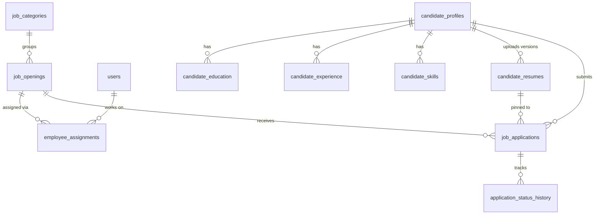

# SolidPro HireAI — Architecture

## 1. Stack (as implemented)

| Layer | Choice |
|---|---|
| Frontend | React 19 + TypeScript, Vite, Tailwind CSS 4, React Router, Axios, TanStack Query, React Hook Form + Zod, Recharts, Lucide |
| Backend | Python 3.12+, FastAPI, SQLAlchemy 2.0 (sync), Alembic, Pydantic v2 |
| Database | PostgreSQL 14+ (psycopg 3) |
| Auth | JWT in an httpOnly, SameSite=Lax cookie (Bearer header also accepted), Argon2 password hashing, RBAC + permission codes |
| Email | SMTP (Mailpit in dev). With no SMTP configured in development, emails are stored in `email_logs` and printed to the server log with status `dev_logged` |
| Later phases | Redis + worker (bulk resume / AI / STT), LLM API, speech-to-text, S3/Azure Blob storage |

### Why sync SQLAlchemy
Simpler to reason about and test. FastAPI runs sync routes in a thread pool, which is more than sufficient for an internal HR tool. Long-running AI work will go to a background worker in Phase 3+, not into request handlers.

## 2. Request flow

```
Browser ──(cookie)──▶ FastAPI router ──▶ dependencies (auth → status → role/permission)
                                      └▶ service layer (business rules, audit, notifications, emails)
                                          └▶ SQLAlchemy models ──▶ PostgreSQL
```

* **Routes** are thin: parse input, call a service, commit, return a schema.
* **Services** hold business rules (registration, approval, token issuing).
* **Dependencies** enforce authentication, account status, `must_change_password`, roles and permissions on the server for every request.

## 3. Account model

Account **types** (`users.role`): `admin`, `employee`, `applicant`. These are separate from recruitment **categories** (CAD, Digital Transform, Intern — Phase 2).

Account **status** (`users.status`):

```
pending_email_verification ──verify──▶ applicant: active
                                   └▶ employee:  pending_approval ──approve──▶ active
                                                                  └─reject──▶ rejected
active ◀──▶ suspended / deactivated   (admin action)
```

Rules enforced in code:
* A SolidPro-domain address never grants privileges by itself — it only routes the user into the **approval queue**. Domains come from the `company_email_domains` table (admin-editable), not from the email provider.
* Only `active` accounts pass authentication on API calls. Pending, rejected, suspended and deactivated users are blocked server-side, even with a previously issued token.
* Admin inherits every Employee operation (`require_permission` passes for admins).
* Employees need an explicit permission code (e.g. `manage_job_openings`) granted by an admin.
* The seeded admin must change the initial password before any other API call succeeds.

## 4. ER diagram — Phase 1 (implemented)

```mermaid
erDiagram
    users ||--o| employee_profiles : has
    users ||--o| candidate_profiles : has
    users ||--o{ employee_approvals : "is decided in"
    users ||--o{ employee_permissions : granted
    permissions ||--o{ employee_permissions : in
    users ||--o{ email_verification_tokens : owns
    users ||--o{ password_reset_tokens : owns
    users ||--o{ notifications : receives
    users ||--o{ audit_logs : "acts in"
    users ||--o{ email_logs : "addressed to"
    users ||--o{ company_email_domains : "created by"

    users {
        int id PK
        string email UK
        string password_hash
        string full_name
        string mobile
        enum role "admin|employee|applicant"
        enum status
        bool must_change_password
        timestamptz email_verified_at
        timestamptz last_login_at
        int token_version
        int failed_login_attempts
        timestamptz locked_until
        timestamptz consent_accepted_at
    }
    employee_profiles { int id PK; int user_id FK_UK; string department; string designation }
    candidate_profiles { int id PK; int user_id FK_UK }
    employee_approvals { int id PK; int employee_id FK; int decided_by FK; enum decision; text reason; jsonb permissions_granted; timestamptz decided_at }
    permissions { int id PK; string code UK; string description; string category }
    employee_permissions { int user_id PK_FK; int permission_id PK_FK; int granted_by FK; timestamptz granted_at }
    email_verification_tokens { int id PK; int user_id FK; string token_hash UK; timestamptz expires_at; timestamptz used_at }
    password_reset_tokens { int id PK; int user_id FK; string token_hash UK; timestamptz expires_at; timestamptz used_at }
    company_email_domains { int id PK; string domain UK; bool is_active; int created_by FK }
    notifications { int id PK; int user_id FK; string type; string title; text message; string link; bool is_read }
    email_logs { int id PK; int user_id FK; string to_email; string subject; string template; enum status; int attempts; text error }
    audit_logs { int id PK; int actor_id FK; string action; string entity_type; string entity_id; jsonb details; string ip_address }
```

Raw verification / reset tokens are never stored — only their SHA-256 hash.

### Phase 2 additions (implemented, migration 0002)



Rules: one application per (candidate, opening); a resume version is immutable and pinned to the application that used it; employee access is scoped through `employee_assignments`; applicant-visible history hides internal comments and reviewer identity; approved / rejected / withdrawn are final.

### Phase 3 additions (implemented, migration 0003)

`resume_analysis_reports` (one row per AI run): `application_id`, `resume_id` (exact version analysed), `status` (completed / failed), `provider`, `model`, `prompt_version`, `is_mock`, `ai_score`, `report` (JSONB, validated), `error`, `requested_by`, and reviewer override fields (`override_score`, `override_note`, `overridden_by`, `overridden_at`). The AI score is never overwritten; the effective score is the override when present.

```
app/ai/
  schemas.py            AnalysisInput (what the model may see), ResumeAnalysisResult (validated output), AIProviderError
  mock_provider.py      deterministic keyword matcher, always labelled MOCK
  anthropic_provider.py Messages API over httpx; untrusted-resume delimiting; JSON parsing + validation
  factory.py            picks the provider from settings; no silent fallback
app/services/analysis_service.py   permissions, run, store, override, audit
```

Flow: staff request -> permission + opening-scope check -> build input (no name / contact / DOB / address) -> provider -> validate and clamp -> store -> audit. Nothing in this path touches `job_applications.status`.

### Phase 4 additions (implemented, migration 0004)

* `question_banks`, `bank_questions`: reusable aptitude content (topic, options, answer key, difficulty, marks, verified-by).
* `assessments` (working draft per application), `assessment_sections` (exactly MCQ, Aptitude, Repeat the Sentence), `assessment_questions` (copies of bank content or AI / manual items, each with a review status).
* `assessment_versions`: immutable snapshots with `content_hash` (SHA-256 of canonical JSON). A PostgreSQL trigger rejects UPDATE and DELETE except for the `published_at` / `published_by` columns.
* `assessment_approvals`: who approved which version, when, the question ids and a diff against the previous version.

```
draft (generated) -> every question approved -> approve assessment -> version n (frozen) -> publish
        ^                                                                  |
        +------------------ any edit reopens the draft; version n stays ---+
```

AI is only asked for MCQ and Repeat-the-Sentence items; aptitude items are picked from the bank. All providers return validated structures; nothing the AI writes is shown to an applicant before a person approves it, and no test can use anything but a published, approved version.

### Phase 5 additions (implemented, migration 0005)

```
published AssessmentVersion ──pinned──> assessment_schedules (token_hash, window, duration, status)
        schedules 1─* reschedule_requests      schedules 1─* schedule_events (activity + client-reported events)
        schedules 1─1 test_attempts (deadline, session_id, question_order JSONB, plays JSONB)
        attempts  1─* attempt_answers (question_id, selected_index = ORIGINAL option index, seq)
        attempts  1─* attempt_recordings (opaque stored_name, mime, size, sha256, attempt_no)
```

* Schedule states: `invited → accepted → in_progress → completed`, plus `expired` and `cancelled`. Expiry is lazy (checked on every read) and swept by a background task.
* The invitation token is random, stored only as a SHA-256 hash, and useless without the invited applicant's login.
* The server owns time: `deadline_at = started_at + duration`; writes after the deadline plus a grace period are refused and the attempt is auto-submitted.
* Answer keys live only in the version snapshot. The runner receives options as `{id: originalIndex, text}` in a per-attempt shuffled order, and Repeat-the-Sentence questions carry no text until the play endpoint is called (server-counted).
* `X-Attempt-Session` makes one browser window the owner of an attempt; resuming rotates it.
* Client events are stored with `client_reported = true`, whitelisted and capped, and have no effect on status or scoring.
* Staff playback goes through `/api/recordings/{id}/file`: permission + opening scope are re-checked and every access is audited.

### Phase 6 additions (implemented, migration 0006)

```
test_attempts 1─1 evaluation_results (draft → final; released_at) 1─* evaluation_items (per question: auto_marks, final_marks, stt_status, details JSONB)
evaluation_results 1─* score_overrides (who, when, original, revised, reason)   1─* evaluation_comments (internal)
attempt_recordings 1─1 recording_transcripts (provider, confidence, text)
job_applications 1─* interviews 1─1 interview_feedback (internal)
```

* A submitted attempt is evaluated in the same transaction: objective items are scored at once, speaking items start as `pending`; speech-to-text then runs as a background task and again from the sweeper (bounded, retried). A sweep also backfills evaluations for older submissions.
* Speech comparison (`services/speech_scoring.py`) aligns expected and heard words with edit distance, credits near matches at half, does not penalise extra words and reports missing / substituted / extra / order. Items with low confidence, empty text or errors get `needs_review` and **no final mark** until a reviewer confirms or overrides; approval is blocked while any item has no final mark.
* `applications.status` gained `shortlisted` and `selected`. Decisions are explicit reviewer actions (`POST /applications/{id}/decision`); shortlisting needs a final evaluation, selecting needs a shortlisted application, rejecting needs a reason.
* Applicants only ever read `/my-results` (finalised and released) and `/my-interviews`. They never receive answer keys, transcripts, comments, interviewer feedback or other candidates' data.
* Provider selection: `STT_PROVIDER=mock|openai` (`STT_API_KEY`, `STT_MODEL`, `STT_BASE_URL`, `STT_MIN_CONFIDENCE`). There is no silent fallback to mock and the UI labels mock speech-to-text.

## 5. Planned schema for later phases

Added by Alembic migrations phase by phase (names follow the specification):

* **Phase 7** — bulk upload jobs, analytics views, configurable email templates.

Key invariants to carry forward: candidate profile ≠ application; one application per (candidate, opening); resume versions preserved; approved assessments are immutable snapshots; no schedule without an approved version.

## 6. API conventions

* Base path `/api`; interactive docs at `/api/docs`.
* Errors: `{"error": {"code": "...", "message": "...", "fields": {...}?}}`.
* Lists: `{"items": [...], "total": n, "page": 1, "page_size": 20, "pages": k}`.
* Sensitive endpoints (login, register, forgot/reset password, resend verification) are rate-limited (in-memory per process; swap for Redis when running several workers).


## 7. Phase 7 additions

* **Tables (migration 0007):** `bulk_batches` (opening, creator, AI provider and mock flag) and `bulk_items` (stored file, extracted fields, advisory score, duplicate links, triage). Items cascade-delete with their batch; files are removed after the rows. Extra indexes on `job_applications`, `application_status_history`, `assessment_schedules` and `evaluation_results` support analytics.
* **Bulk flow:** `POST /api/bulk-batches` validates and stores files, returns 202, and a background task (`bulk_service.run_batch`) claims queued items with `FOR UPDATE SKIP LOCKED`, commits per file, retries up to `BULK_MAX_ATTEMPTS`, and the sweeper recovers items stuck in `processing`. Extraction is `resume_extract.py` (regex heuristics); scoring reuses the AI provider layer with `AnalysisInput` (no name or contact details).
* **Access:** `bulk_upload_resumes` plus assignment to the opening; analytics need `view_analytics` and are restricted to `access.staff_scope`. Comparison also needs `review_applications` because it shows names.
* **Analytics:** `analytics_service.recruitment` computes everything on demand from real rows; rate denominators are returned with the numbers and definitions in `notes`. Exports go through `export_service`, which prefixes cells beginning with `= + - @` to stop spreadsheet formula injection.
* **Deployment:** `backend/Dockerfile`, `frontend/Dockerfile` + `nginx.conf`, `docker-compose.prod.yml`, `docs/DEPLOYMENT.md`.
